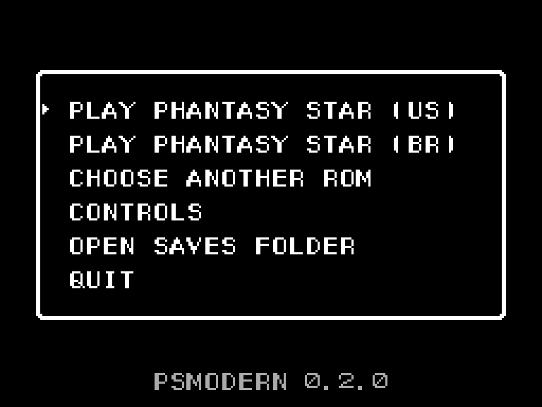
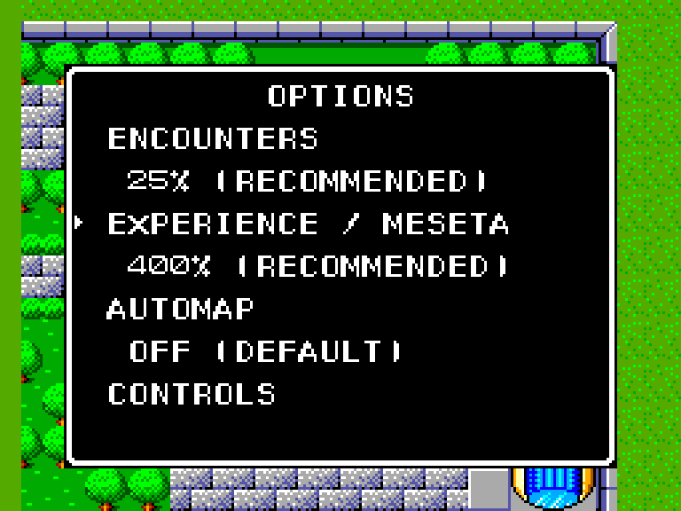

# PSModern

English | [Português (Brasil)](README.pt-BR.md)

[](https://github.com/carbiecarbie/psmodern/actions/workflows/ci.yml?query=branch%3Amain)
[](https://github.com/carbiecarbie/psmodern/releases)
[](LICENSE)

> [!IMPORTANT]
> PSModern is an unofficial fan project in an early stage. It ships no game
> data: you need your own dump of the Phantasy Star cartridge for the Sega
> Master System, either the US Rev-A or the Brazilian Tec Toy release.

PSModern is an open-source reimplementation of **Phantasy Star** (Sega Master
System, 1987/88) in C++. It runs on your own cartridge dump and aims to look,
sound, play and keep time exactly like the original. Anything the cartridge
never had, such as adjustable encounters and experience or fast-forward, is
an option, and the options start off.

The original program runs on a virtual Z80 from day one. Its routines are
rewritten in C++ one at a time, and each rewrite is checked against the
original, call by call and frame by frame, until no Z80 code is left. Along
the way the project writes down [how the game works inside][how-it-works].

| Start screen | Options |
| --- | --- |
|  |  |

## What works today

The whole game can be played, in English (US) or Portuguese (Brazilian Tec
Toy release). Controller polling, the random numbers, the random-encounter
checks, experience, battle setup, battle money and walking in the dungeons
already run in C++; the rest of the game still runs on the virtual Z80.

What you get today:

- A Windows (64-bit) version, with a start screen that remembers your ROMs.
- The original 256x192 picture, scaled in whole steps, in a window or
  fullscreen.
- The original sound chip, music and effects.
- Keyboard or game controller, both at the same time if you like, with every
  key and button changeable on an in-game Controls screen.
- Three options you set inside the game: how often random fights happen,
  how much experience and battle money each fight gives, and a map of the
  dungeons.
- 2x and 4x fast-forward, with the music kept at its normal tempo.

The [roadmap][roadmap] lists what comes next: text and language selection,
and widescreen on the world map and in towns.

## Download and play

You need a dump of your own cartridge: an uncompressed `.sms` file (not
zipped) of one of these releases.

| Release | SHA-1 |
| --- | --- |
| US Rev-A | `07fcf297be4f4c9d92cd3f119a7ac48467e06838` |
| Brazilian (Tec Toy) | `fd8dad6acb6fa75dc8e9bbaea2a7e9fd486fc2dd` |

PSModern refuses any other file and tells you why.

1. Download `PSModern-<version>-windows-x64.zip` from the
   [releases page][releases].
2. Unzip it into a folder of its own.
3. Double-click `psmodern.exe`. The first time, pick your `.sms` file in the
   Open dialog; PSModern remembers it.
4. On the start screen, choose the version to play. The same screen lets you
   pick another ROM, open the Controls screen, open the saves folder or quit.

The program is not digitally signed, so Windows SmartScreen may warn about an
unknown publisher. Click **More info**, then **Run anyway**.

## Controls

The table shows the defaults. Every key and button can be changed on the
Controls screen, from the start screen or from the Options window, and your
choice is kept in `controls.txt`. [Controls][controls] has the full list and
the steps.

| Console | Keyboard | Game controller |
| --- | --- | --- |
| Directional pad | Arrow keys | D-pad or left stick |
| Button 1 / Button 2 | Z / X | A / B |
| Pause | Enter | Start |
| Reset | Backspace | Back |
| Power off and on | F5 | - |
| Speed 1x / 2x / 4x | Tab | Right shoulder (R / RB) |
| Options window | Escape | Y |
| Dungeon map (Automap option on) | M | X |
| Window or fullscreen | Alt+Enter | - |

The first controller found is used, including one plugged in during play.
The start screen always uses the defaults (arrows, Z or Enter, Escape; D-pad,
A or Start), so CONTROLS stays within reach whatever you set.
Controller buttons are named by position: A is the bottom one, whatever is
printed on your pad.

### Fast-forward

Each press of Tab (or RB) moves to the next speed: 1x, 2x, 4x, then back to
1x. An indicator shows while the game runs faster. Music and sound effects
keep their normal tempo and pitch. Every session starts at 1x, and so does
F5. While the Options window is open, or the window loses focus, the game
runs at 1x and then goes back to the speed you chose.

## Options

Press Escape (or Y on a controller, or whatever you set) while walking around
a town, the world map or a dungeon. Up and down pick a row, left and right change its value. Z
(or A) saves and closes, and X or B (or Escape/Y) closes without saving. The
scene stays behind the window and the music keeps playing.

| Option | Values | What it does |
| --- | --- | --- |
| Encounters | 0, 25, 50, 100, 200% | How often random fights start. 0 turns them off. Story and fixed fights never change. |
| Experience / Meseta | 100, 200, 400% | Experience and money from each fight. A character still gains at most one level per fight. |
| Automap | Off, On | A map of the dungeon floor you are on. Off by default. |
| CONTROLS | - | Opens the Controls screen to change keys and buttons. |

100% is the original game and is marked DEFAULT. Encounters at 25% and
experience at 400% are marked RECOMMENDED; together they give the pace of
the Nintendo Switch release's easy mode (a quarter of the encounters, four
times the experience and money). A change applies once the current action
ends, so a battle in progress, its rewards included, finishes under the old
rates. The window title shows the active rates and any change still waiting.

The choice is saved for that version's whole save file, so all five of the
game's save slots share it.

### Automap

With the Automap option on, press M (or X on a controller) while walking in a
dungeon to see a map of the floor you are on, with a floor label at the top
of the map (FLOOR 1 is the lowest floor that has an exit to the outside,
FLOOR 2 above it, FLOOR B1 below it); M, X, Escape or B close it. The game
waits while the map is open and the music keeps playing. The map shows
only what you have seen: corridors, walls, doors (plain, locked and magic),
stairs, exits to the outside, and chests, opened or not. A pitfall appears
once you have fallen through it and a hidden passage once you have walked
through it; the bosses and guardians are never marked. The map is kept with
each saved game, so Continue brings back the map of that game, and a new game
starts with an empty one. Exploration is recorded even while the option is
off, so turning it on later shows what you have already seen.

## Saves

You save through the game's own menu, as on the cartridge. PSModern keeps
its files in `%APPDATA%\PSModern`, one set per version:

- the save itself, in the cartridge's format, so other emulators can read it;
- a small companion file with your options;
- a file with the dungeon maps of your saved games;
- a `.bak` copy of the previous save, made before the first write of each
  session.

If you copy only the raw save to another emulator, your progress goes with
it but the options don't; a raw save without its companion file plays with
the original rules. Turning the options back to 100% keeps the experience
and money already earned. Only one running copy of PSModern can use a save at
a time. To make PSModern forget your ROMs, delete `roms.txt` from that folder.

## Command line

`psmodern.exe` also takes a ROM path and the two options, which then apply to
that session only:

```sh
psmodern.exe "path/to/your-game.sms" --encounter-rate 25 --experience-rate 400
psmodern.exe --version
```

`--encounter-rate` takes 0, 25, 50, 100 or 200 and `--experience-rate` takes 100,
200 or 400. A flag you leave out uses the saved choice, and an explicit 100
overrides a saved one. Flags are only saved if you confirm them in the
Options window. The developer modes `--record` and `--no-routines` always
use the original rules and refuse any other value; [development][development]
has the details.

## About the project

- [Project status][status]: what runs now, the architecture and the known
  gaps.
- [Roadmap][roadmap]: the next milestones.
- [Project history][history]: the finished milestones.
- [How it works][how-it-works]: the console, the controls, the random
  numbers, the party and the sound, explained for readers who don't program.
- [Original quirks][quirks]: oddities of the original kept on purpose, and
  the differences between the US and Brazilian versions.
- [Design][design]: the goals and the decisions behind them.

## Building

Development uses Windows x86-64 with the
[pinned MSYS2 UCRT64 toolchain][dependencies]. In a UCRT64 shell:

```sh
cmake -S . -B build-rel -G Ninja -DCMAKE_BUILD_TYPE=RelWithDebInfo
cmake --build build-rel
ctest --test-dir build-rel --output-on-failure
./build-rel/psmodern.exe "path/to/your-game.sms"
```

Without a ROM path, `psmodern.exe` opens the start screen. Tests that need a
ROM skip themselves when it is missing. [Development][development] covers the
ROM test paths, the input recordings, the replay runner and the comparison
against the original.

## Disclaimer and license

PSModern is unofficial and is not affiliated with or endorsed by SEGA or Tec
Toy. Phantasy Star is a trademark of SEGA.

PSModern is distributed under the GNU General Public License version 3 or, at
your option, any later version (GPL-3.0-or-later). The release zip's
`THIRD-PARTY.txt` lists the bundled libraries and their licenses.

[releases]: https://github.com/carbiecarbie/psmodern/releases
[status]: docs/project-status.md
[roadmap]: docs/roadmap.md
[history]: docs/project-history.md
[how-it-works]: docs/how-it-works/
[quirks]: docs/original-quirks.md
[design]: docs/design.md
[dependencies]: docs/dependencies.md
[controls]: docs/player-controls.md
[development]: docs/development.md
