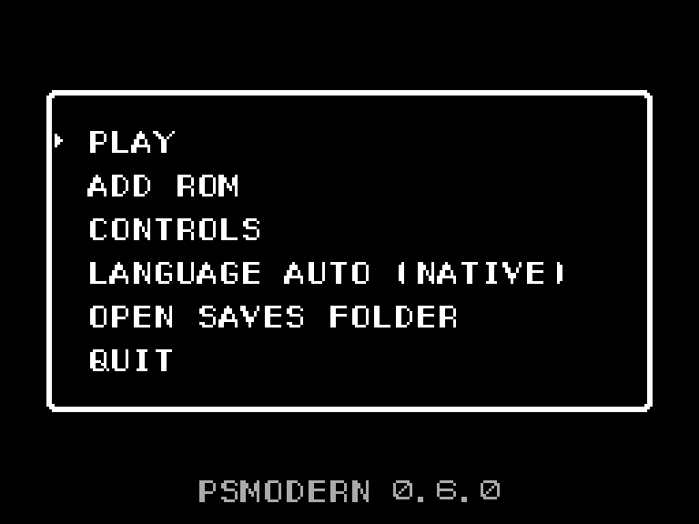
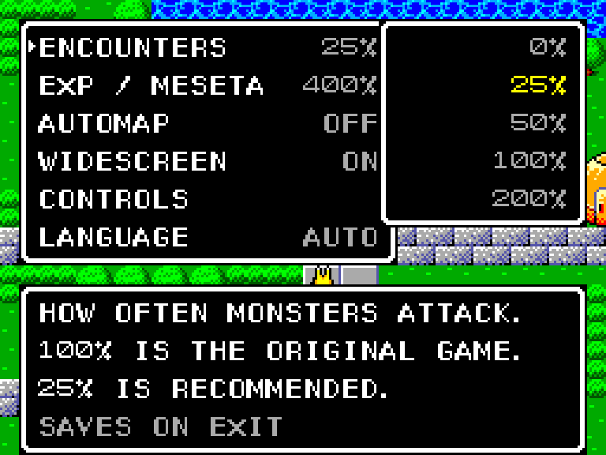
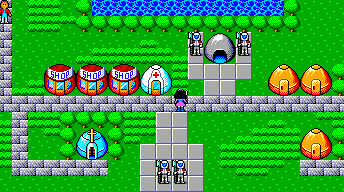

# PSModern

English | [Português (Brasil)](README.pt-BR.md)

[](https://github.com/carbiecarbie/psmodern/actions/workflows/ci.yml?query=branch%3Amain)
[](https://github.com/carbiecarbie/psmodern/releases)
[](LICENSE)

> [!IMPORTANT]
> PSModern is an unofficial fan project and includes **no game data**. You need
> your own dump of the Sega Master System **Phantasy Star** cartridge (US Rev-A
> or the Brazilian Tec Toy release).

**PSModern** is an open-source C++ reimplementation of **Phantasy Star** (Sega
Master System, 1987/88). **The entire game is playable from start to finish** in
English or Portuguese, with the same picture, sound, rules, and timing as the
original cartridge — plus optional quality-of-life features that all start off.

| Start screen | Options | Widescreen |
| --- | --- | --- |
|  |  |  |

## Rebuilt in C++, no Z80 emulator

PSModern started by running the original cartridge on a virtual Z80 and
rewriting its routines in C++ one by one, checking every change against the
original. That work is complete: **`psmodern.exe` runs pure C++ and contains no
Z80 interpreter.** Your ROM is used only as a data source for graphics, maps,
text, and music.

The Z80 still lives in the test suite as a referee, running beside the C++ code
to verify state and cycle timing instruction by instruction. Along the way, we
documented [how the game works inside][how-it-works] in plain language.

## Optional features

With every option off, PSModern plays identically to the original cartridge.
Turn on only what you want from the in-game **Options** menu (`Escape` or
controller `Y` while exploring):

- **Adjustable encounters & rewards:** scale random encounters (`0%` to `200%`)
  and battle EXP / Meseta (`100%` to `400%`). Setting **25% encounters** and
  **400% EXP / Meseta** gives a pace similar to the Nintendo Switch SEGA AGES
  easy mode. Story and fixed fights never change.
- **Dungeon automap:** press `M` (or controller `X`) inside a dungeon to view
  the parts of the current floor you have explored, saved alongside each slot.
- **16:9 widescreen:** widens the world map, towns, and spaceship flights to
  `344x192` using the cartridge's own map data and tiles. Battles, menus, and
  dungeons stay centered in their original `256x192` frame.
- **Fast-forward (`1x` / `2x` / `4x`):** press `Tab` (or `RB`) to speed up
  gameplay while keeping music and sound effects at normal tempo and pitch.
- **Live language switching:** switch between English and Portuguese during
  exploration without restarting (when both ROMs are added), sharing one save
  file across both languages.
- **Japanese FM soundtrack:** if you also own the Japanese cartridge, hear its
  FM music and sound effects while you play, switching between `PSG` and `FM`
  on the **SOUND** row at any time.
- **Full control remapping:** keyboard and gamepad work together, and every key
  and button can be remapped from the in-game **Controls** screen.
- **Android support:** official ARM APK for Android 7.0+ with touch controls,
  gamepad support, and saves compatible with Windows.

## How to install and play

### What you need

An uncompressed `.sms` dump of your own cartridge (unzipped). PSModern checks
the file and refuses unsupported dumps with an explanation.

| Release | SHA-1 |
| --- | --- |
| US Rev-A | `07fcf297be4f4c9d92cd3f119a7ac48467e06838` |
| Brazilian (Tec Toy) | `fd8dad6acb6fa75dc8e9bbaea2a7e9fd486fc2dd` |

**Japanese FM sound (optional, from 1.3.0).** Use **ADD ROM** with your own
Japanese cartridge (SHA-1 `c9a40ddd217c58dddcd6b5c0fe66c3a50d3e68e4`).
It supplies music and sound effects for either playable cartridge. PSG is
the default; choose FM on the SOUND row of Options. [Sound sources and preferences](docs/player-controls.md#sound).

### Windows (ready to play)

1. Download `PSModern-<version>-windows-x64.zip` from the
   [Releases page][releases].
2. Extract the zip into its own folder.
3. Double-click `psmodern.exe`. On first launch, select your `.sms` file in the
   Open dialog — PSModern remembers it from then on.
4. Pick **PLAY** on the start screen. Use **ADD ROM** if you also have the other
   language's cartridge, and **LANGUAGE** or **CONTROLS** to customize your
   setup.

> [!NOTE]
> Because `psmodern.exe` is not digitally signed, Windows SmartScreen may show
> an "unknown publisher" warning. Click **More info** and then **Run anyway**.

### Android (ARM, Android 7.0+)

1. Download `PSModern-<version>-android-arm.apk` from the
   [Releases page][releases] on your phone and install it (you may need to allow
   **Install unknown apps** for your browser or file manager).
2. Open **PSModern** and select your uncompressed `.sms` file in the Android
   file picker — the app keeps an internal copy.
3. Tap **1** on **PLAY** to start. Use **ADD ROM** to import the other
   language's cartridge. Both portrait and landscape layouts are supported.

*(Want to build the APK yourself? Follow the
[Android build guide](docs/dependencies.md#android-family-build).)*

To move saves between Windows and Android, close PSModern on both devices, back
up the destination folder, and copy the files inside `shared/`:

- **Windows:** `%APPDATA%\PSModern\shared`
- **Android:** `Android/data/org.psmodern.game/files/shared/`

## Quick controls

Keyboard and the first connected controller work at the same time. Everything
can be customized on the **Controls** screen (from the start screen or Options).

| Action | Keyboard | Controller |
| --- | --- | --- |
| Move | Arrow keys | D-pad or left stick |
| Button 1 / Button 2 | `Z` / `X` | `A` / `B` (positional) |
| Pause / Reset | `Enter` / `Backspace` | `Start` / `Back` |
| Power cycle | `F5` | - |
| Fast-forward (`1x`/`2x`/`4x`) | `Tab` | `RB` (right shoulder) |
| Options menu | `Escape` | `Y` |
| Dungeon map (when Automap is on) | `M` | `X` |
| Fullscreen | `Alt+Enter` | - |

Saves use the original cartridge format in `%APPDATA%\PSModern\shared` (with a
`.bak` backup and small companion files for options and dungeon maps), so your
raw `.sav` remains compatible with Master System emulators. You can also launch
directly from the command line:

```sh
psmodern.exe "path/to/your-game.sms" --encounter-rate 25 --experience-rate 400
```

See the [Player guide & controls][controls] for full details on remapping,
options, automap rules, widescreen, saves, and command-line flags.

## Building from source

Windows builds use the [pinned MSYS2 UCRT64 toolchain][dependencies]. From a
UCRT64 shell:

```sh
cmake -S . -B build-rel -G Ninja -DCMAKE_BUILD_TYPE=RelWithDebInfo
cmake --build build-rel
ctest --test-dir build-rel --output-on-failure
./build-rel/psmodern.exe "path/to/your-game.sms"
```

Tests that need a ROM skip automatically if none is configured. See
[Development][development] for ROM test paths, recordings, and lockstep
verification.

## Documentation

- [How the game works inside][how-it-works] — plain-language chapters covering
  the Master System hardware, controls, random numbers, party, sound, dungeons,
  text, world map, menus, battles, interactions, scenes, and interrupts.
- [Player guide & controls][controls] — controls, options, automap, widescreen,
  saves, and CLI flags.
- [Project status][status] & [Roadmap][roadmap] — current architecture,
  verification summary, and future ideas.
- [Project history][history] — milestone-by-milestone log.
- [Original quirks][quirks] — original cartridge oddities kept on purpose and
  differences between the US and Brazilian versions.
- [Design][design] — goals and architectural decisions.

## Disclaimer and license

PSModern is unofficial and is not affiliated with or endorsed by SEGA or Tec
Toy. Phantasy Star is a trademark of SEGA.

Licensed under the GNU General Public License v3.0 or later
([GPL-3.0-or-later](LICENSE)). Bundled runtime libraries and their licenses are
listed in the release zip's `THIRD-PARTY.txt`.

[releases]: https://github.com/carbiecarbie/psmodern/releases
[how-it-works]: docs/how-it-works/README.md
[controls]: docs/player-controls.md
[status]: docs/project-status.md
[roadmap]: docs/roadmap.md
[history]: docs/project-history.md
[quirks]: docs/original-quirks.md
[design]: docs/design.md
[dependencies]: docs/dependencies.md
[development]: docs/development.md
