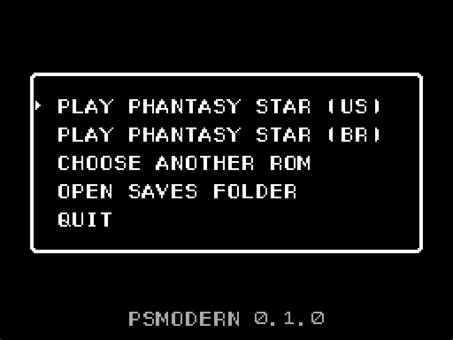
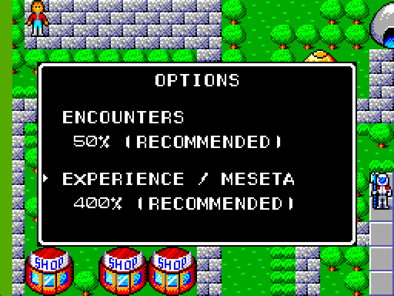

# PSModern

[English](README.md) | Português (Brasil)

[](https://github.com/carbiecarbie/psmodern/actions/workflows/ci.yml?query=branch%3Amain)
[](https://github.com/carbiecarbie/psmodern/releases)
[](LICENSE)

> [!IMPORTANT]
> O PSModern é um projeto de fã, não oficial, e ainda está no começo. Ele não
> vem com nenhum dado do jogo: você precisa de um dump do seu próprio cartucho
> de Phantasy Star para Master System, da versão americana (US Rev-A) ou da
> versão brasileira da Tec Toy.

O PSModern é uma reimplementação de código aberto de **Phantasy Star** (Sega
Master System, 1987/88) em C++. Ele roda a partir do dump do seu cartucho e
quer ter a mesma imagem, o mesmo som, a mesma jogabilidade e o mesmo ritmo do
original. Tudo o que o cartucho não tinha, como ajustar encontros e
experiência ou acelerar o jogo, é opcional, e as opções começam desligadas.

Desde o primeiro dia o programa original roda num Z80 virtual. As rotinas
dele são reescritas em C++ uma de cada vez, e cada uma é conferida com o
original, chamada por chamada e quadro por quadro, até não sobrar código Z80.
No caminho, o projeto documenta [como o jogo funciona por dentro][how-it-works]
(em inglês).

| Tela inicial | Opções |
| --- | --- |
|  |  |

## O que já funciona

Dá para jogar o jogo inteiro, em inglês (versão americana) ou em português
(versão brasileira da Tec Toy). A leitura do controle, os números aleatórios,
a checagem de encontros aleatórios, a experiência, a preparação das batalhas e
o dinheiro das batalhas já rodam em C++; o resto do jogo ainda roda no Z80
virtual.

O que você tem hoje:

- Uma versão para Windows (64 bits), com uma tela inicial que lembra das suas
  ROMs.
- A imagem original de 256x192, ampliada em passos inteiros, em janela ou em
  tela cheia.
- O chip de som original, com as músicas e os efeitos.
- Teclado ou controle, ou os dois ao mesmo tempo.
- Duas opções que você ajusta dentro do jogo: a frequência das lutas
  aleatórias e quanto de experiência e dinheiro cada luta dá.
- Aceleração de 2x e 4x, com a música no ritmo normal.

O [roteiro][roadmap] mostra o que vem depois: masmorras e um mapa automático,
depois texto e escolha de idioma, suporte completo a controle e tela
widescreen no mapa-múndi e nas cidades.

## Baixar e jogar

Você precisa de um dump do seu próprio cartucho: um arquivo `.sms` sem
compactação (fora do zip) de uma destas versões.

| Versão | SHA-1 |
| --- | --- |
| Americana (US Rev-A) | `07fcf297be4f4c9d92cd3f119a7ac48467e06838` |
| Brasileira (Tec Toy) | `fd8dad6acb6fa75dc8e9bbaea2a7e9fd486fc2dd` |

O PSModern recusa qualquer outro arquivo e diz o motivo.

1. Baixe o `PSModern-<versão>-windows-x64.zip` na
   [página de releases][releases].
2. Descompacte numa pasta só para ele.
3. Dê dois cliques em `psmodern.exe`. Na primeira vez, escolha o seu arquivo
   `.sms` na janela de abrir arquivo; o PSModern guarda essa escolha.
4. Na tela inicial, escolha a versão que quer jogar. A mesma tela permite
   escolher outra ROM, abrir a pasta de saves ou sair.

O programa não tem assinatura digital, então o SmartScreen do Windows pode
avisar que o editor é desconhecido. Clique em **Mais informações** e depois em
**Executar assim mesmo**.

## Controles

| Console | Teclado | Controle |
| --- | --- | --- |
| Direcional | Setas | D-pad ou analógico esquerdo |
| Botão 1 / Botão 2 | Z / X | A / B |
| Pause | Enter | Start |
| Reset | Backspace | Back |
| Desligar e ligar | F5 | - |
| Velocidade 1x / 2x / 4x | Tab | Botão de ombro direito (R / RB) |
| Janela de opções | Escape | Y |
| Janela ou tela cheia | Alt+Enter | - |

O PSModern usa o primeiro controle que encontrar, mesmo que ele seja
conectado no meio do jogo.

### Aceleração

Cada toque em Tab (ou RB) passa para a próxima velocidade: 1x, 2x, 4x e de
volta a 1x. Um indicador aparece enquanto o jogo está acelerado. A música e os
efeitos sonoros continuam no ritmo e no tom normais. Toda sessão começa em 1x,
e o F5 também volta para 1x. Com a janela de opções aberta, ou quando a janela
do jogo perde o foco, o jogo roda em 1x e depois volta para a velocidade que
você escolheu.

## Opções

Aperte Escape (ou Y no controle) enquanto anda por uma cidade, pelo mapa-múndi
ou por uma masmorra. Para cima e para baixo escolhem a linha, esquerda e
direita mudam o valor. Z (ou A) salva e fecha, e X ou B (ou Escape/Y) fecha
sem salvar. A cena continua atrás da janela e a música não para.

| Opção | Valores | O que faz |
| --- | --- | --- |
| Encounters (encontros) | 0, 50, 100, 200% | Frequência das lutas aleatórias. 0 desliga. As lutas da história e as fixas não mudam. |
| Experience / Meseta | 100, 200, 400% | Experiência e dinheiro de cada luta. Um personagem continua subindo no máximo um nível por luta. |

100% é o jogo original e aparece como DEFAULT. Encontros em 50% e experiência
em 400% aparecem como RECOMMENDED; juntos, deixam o ritmo parecido com o do
relançamento para Nintendo Switch. Uma mudança vale quando a ação atual
termina, então uma batalha em andamento, recompensas incluídas, termina com os
valores antigos. O título da janela mostra os valores ativos e qualquer
mudança que ainda esteja esperando.

A escolha fica salva para o arquivo de save inteiro daquela versão, então os
cinco espaços de save do jogo usam a mesma.

## Saves

Você salva pelo menu do próprio jogo, como no cartucho. O PSModern guarda os
arquivos em `%APPDATA%\PSModern`, um conjunto por versão:

- o save em si, no formato do cartucho, que outros emuladores conseguem ler;
- um arquivo pequeno ao lado, com as suas opções;
- uma cópia `.bak` do save anterior, feita antes da primeira gravação de cada
  sessão.

Se você copiar só o save para outro emulador, o progresso vai junto, mas as
opções não; um save sem o arquivo de opções roda com as regras originais.
Voltar as opções para 100% mantém a experiência e o dinheiro já ganhos. Só uma
cópia do PSModern aberta pode usar um save de cada vez. Para o PSModern
esquecer as suas ROMs, apague o `roms.txt` dessa pasta.

## Linha de comando

O `psmodern.exe` também aceita o caminho da ROM e as duas opções, que então
valem só para aquela sessão:

```sh
psmodern.exe "caminho/para/o-seu-jogo.sms" --encounter-rate 50 --experience-rate 400
psmodern.exe --version
```

O `--encounter-rate` aceita 0, 50, 100 ou 200 e o `--experience-rate` aceita
100, 200 ou 400. Uma opção que você não passar usa o valor salvo, e um 100
explícito ignora o valor salvo. Os valores da linha de comando só ficam salvos
se você confirmar na janela de opções. Os modos de desenvolvimento `--record`
e `--no-routines` usam sempre as regras originais e recusam qualquer outro
valor; os detalhes estão em [desenvolvimento][development].

## Sobre o projeto

A documentação do projeto é em inglês.

- [Situação do projeto][status]: o que roda agora, a arquitetura e o que
  ainda falta.
- [Roteiro][roadmap]: os próximos marcos.
- [Histórico][history]: os marcos já concluídos.
- [Como funciona][how-it-works]: o console, os controles, os números
  aleatórios, o grupo e o som, explicados para quem não programa.
- [Peculiaridades do original][quirks]: esquisitices do original mantidas de
  propósito e as diferenças entre as versões americana e brasileira.
- [Design][design]: os objetivos e as decisões por trás deles.

## Compilando

O desenvolvimento usa Windows x86-64 com o
[conjunto de ferramentas MSYS2 UCRT64 fixado][dependencies]. Num shell UCRT64:

```sh
cmake -S . -B build-rel -G Ninja -DCMAKE_BUILD_TYPE=RelWithDebInfo
cmake --build build-rel
ctest --test-dir build-rel --output-on-failure
./build-rel/psmodern.exe "caminho/para/o-seu-jogo.sms"
```

Sem o caminho da ROM, o `psmodern.exe` abre a tela inicial. Os testes que
precisam de ROM se pulam sozinhos quando ela não está lá. Em
[desenvolvimento][development] estão os caminhos das ROMs de teste, as
gravações de entrada, o executor de replays e a comparação com o original.

## Aviso legal e licença

O PSModern não é oficial e não tem ligação nem aprovação da SEGA ou da Tec
Toy. Phantasy Star é marca registrada da SEGA.

O PSModern é distribuído sob a GNU General Public License versão 3 ou, se
você preferir, qualquer versão posterior (GPL-3.0-or-later). O arquivo
`THIRD-PARTY.txt` do zip da release lista as bibliotecas incluídas e as
licenças delas.

[releases]: https://github.com/carbiecarbie/psmodern/releases
[status]: docs/project-status.md
[roadmap]: docs/roadmap.md
[history]: docs/project-history.md
[how-it-works]: docs/how-it-works/
[quirks]: docs/original-quirks.md
[design]: docs/design.md
[dependencies]: docs/dependencies.md
[development]: docs/development.md
