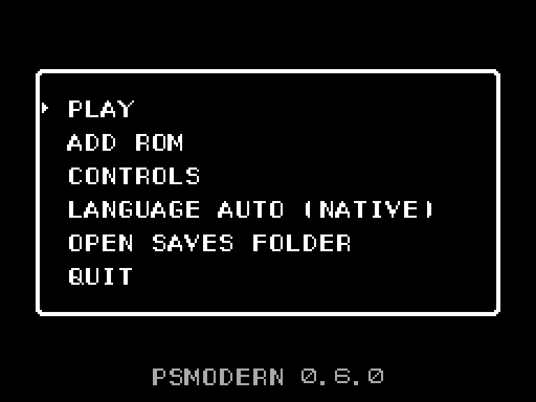
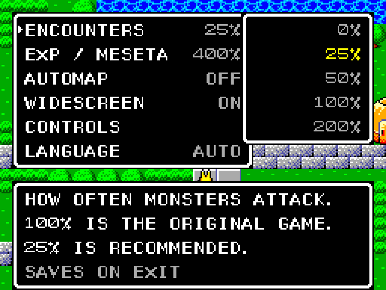
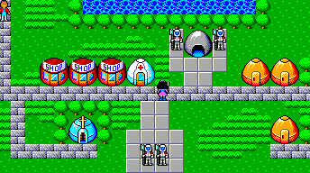

# PSModern

[English](README.md) | Português (Brasil)

[](https://github.com/carbiecarbie/psmodern/actions/workflows/ci.yml?query=branch%3Amain)
[](https://github.com/carbiecarbie/psmodern/releases)
[](LICENSE)

> [!IMPORTANT]
> O PSModern é um projeto de fã, não oficial, e **não inclui nenhum dado do
> jogo**. Você precisa de um dump do seu próprio cartucho de **Phantasy Star**
> para Master System (versão americana US Rev-A ou brasileira da Tec Toy).

O **PSModern** é uma reimplementação de código aberto em C++ de **Phantasy
Star** (Sega Master System, 1987/88). **O jogo inteiro já é jogável do começo ao
fim** em inglês ou português, preservando a imagem, o som, as regras e o ritmo
do cartucho original — com recursos modernos opcionais que começam todos
desligados.

| Tela inicial | Opções | Tela larga |
| --- | --- | --- |
|  |  |  |

## Reescrito em C++, sem emulador Z80

O projeto começou rodando o cartucho original em um Z80 virtual e reescrevendo
cada rotina em C++, uma por uma, comparando tudo com o original. Essa etapa
terminou: **o `psmodern.exe` hoje roda só C++ e não contém nenhum interpretador
Z80.** A sua ROM serve apenas como fonte de dados (gráficos, mapas, textos e
músicas).

O Z80 continua existindo apenas na suíte de testes, atuando como juiz ao lado do
código em C++ para conferir estado e ciclos instrução por instrução. No caminho,
documentamos [como o jogo funciona por dentro][how-it-works] (em inglês), em
linguagem acessível para quem não programa.

## Recursos opcionais

Com todas as opções desligadas, o PSModern se comporta exatamente como o
cartucho original. Você ativa só o que quiser pelo menu **Opções** dentro do
jogo (`Escape` ou botão `Y` no controle durante a exploração):

- **Encontros e recompensas ajustáveis:** controle a frequência de batalhas
  aleatórias (`0%` a `200%`) e o ganho de EXP / Meseta (`100%` a `400%`). Usar
  **25% de encontros** e **400% de EXP / Meseta** deixa o ritmo parecido com o
  modo fácil do relançamento SEGA AGES no Nintendo Switch. Lutas fixas e da
  história não mudam.
- **Automapa de masmorras:** aperte `M` (ou `X` no controle) dentro de uma
  masmorra para ver os trechos já explorados do andar atual (`ANDAR 1`, `ANDAR
  B1`, etc.), salvo junto com cada partida.
- **Tela larga (Widescreen):** amplia o mapa-múndi, as cidades e o voo da
  nave para `344x192` usando os próprios mapas e tiles do cartucho. Batalhas,
  menus e masmorras continuam centralizados nos `256x192` originais. Escolha
  SIM para ampliar em múltiplos inteiros ou TOTAL para aproveitar mais da
  tela com uma leve suavização.
- **Aceleração (`1x` / `2x` / `4x`):** aperte `Tab` (ou `RB`) para acelerar o
  jogo mantendo a música e os efeitos sonoros no andamento e tom normais.
- **Troca de idioma ao vivo:** alterne entre inglês e português durante a
  exploração sem reiniciar o jogo (quando tiver as duas ROMs adicionadas),
  usando um único arquivo de save compartilhado.
- **Trilha sonora FM japonesa:** se você também tiver o cartucho japonês, ouça
  a música e os efeitos sonoros em FM enquanto joga, alternando entre `PSG` e
  `FM` na linha **SOM** a qualquer momento.
- **Controles configuráveis:** teclado e controle funcionam juntos, e todas as
  teclas e botões podem ser alterados na tela **CONTROLES** dentro do jogo.
- **Versão para Android:** APK oficial para aparelhos ARM com Android 7.0+,
  controles na tela, suporte a controle físico e saves compatíveis com o
  Windows.
- **Versão para macOS:** um único app universal para Macs com Apple silicon e
  Intel (macOS 11+), com saves compatíveis com Windows e Android.

## Como instalar e jogar

### O que você precisa

Um dump `.sms` do seu próprio cartucho, **descompactado** (fora do `.zip`). O
PSModern valida o arquivo e avisa se a ROM não for uma das versões aceitas.

| Versão | SHA-1 |
| --- | --- |
| Americana (US Rev-A) | `07fcf297be4f4c9d92cd3f119a7ac48467e06838` |
| Brasileira (Tec Toy) | `fd8dad6acb6fa75dc8e9bbaea2a7e9fd486fc2dd` |

**Som FM japonês (opcional, a partir da 1.3.0).** Use **ADICIONAR ROM**
com a cópia do seu cartucho japonês (SHA-1 `c9a40ddd217c58dddcd6b5c0fe66c3a50d3e68e4`).
Ele fornece a música e os efeitos sonoros para jogar com o cartucho americano
ou brasileiro. O PSG é o padrão; escolha FM na linha SOM das Opções. [Fontes e preferências de som](docs/player-controls.md#sound).

### Windows (pronto para jogar)

1. Baixe `PSModern-<versão>-windows-x64.zip` na [página de Releases][releases].
2. Extraia o conteúdo do `.zip` em uma pasta própria.
3. Dê dois cliques em `psmodern.exe`. Na primeira vez, selecione o seu arquivo
   `.sms` na janela que abrir — o PSModern passa a lembrar dele
   automaticamente.
4. Na tela inicial, escolha **JOGAR** (ou **PLAY**, se estiver em inglês). Use
   **ADICIONAR ROM** para incluir a outra versão do cartucho e **IDIOMA** ou
   **CONTROLES** para ajustar do seu jeito.

> [!NOTE]
> Como o `psmodern.exe` não tem assinatura digital, o Windows SmartScreen pode
> exibir um aviso de "editor desconhecido". Clique em **Mais informações** e
> depois em **Executar assim mesmo**.

### macOS (Apple silicon e Intel, macOS 11+)

1. Baixe `PSModern-<versão>-macos-universal.zip` na
   [página de Releases][releases] e abra o arquivo.
2. Arraste o `PSModern.app` para a pasta Aplicativos.
3. Use como no Windows: na primeira vez, selecione o seu arquivo `.sms` na
   janela que abrir e escolha **JOGAR** na tela inicial.

> [!NOTE]
> O app não é notarizado pela Apple, então o macOS bloqueia a primeira
> abertura. Clique no `PSModern.app` com a tecla Control pressionada, escolha
> **Abrir** e depois **Abrir** de novo. No macOS 15 ou mais novo, tente abrir
> uma vez e depois clique em **Abrir Mesmo Assim** em **Ajustes do Sistema >
> Privacidade e Segurança**.

### Android (ARM, Android 7.0+)

1. Baixe `PSModern-<versão>-android-arm.apk` na [página de Releases][releases]
   pelo celular e instale (pode ser necessário permitir **Instalar apps
   desconhecidos** para o navegador ou gerenciador de arquivos).
2. Abra o **PSModern** e selecione seu arquivo `.sms` descompactado no seletor
   do Android — o app guarda uma cópia interna.
3. Toque em **1** sobre **JOGAR** para começar. Use **ADICIONAR ROM** para
   importar o cartucho do outro idioma. Funciona tanto em pé quanto deitado.

*(Quer compilar o APK por conta própria? Siga o
[guia de compilação Android](docs/dependencies.md#android-family-build), em
inglês.)*

Para transferir saves entre Windows, macOS e Android, feche o PSModern nos dois
aparelhos, faça backup da pasta de destino e copie os arquivos de dentro de
`shared/`:

- **Windows:** `%APPDATA%\PSModern\shared`
- **macOS:** `~/Library/Application Support/PSModern/shared`
- **Android:** `Android/data/org.psmodern.game/files/shared/`

## Controles rápidos

Teclado e o primeiro controle conectado funcionam ao mesmo tempo. Tudo pode ser
remapeado na tela **CONTROLES** (pela tela inicial ou pelo menu Opções).

| Ação | Teclado | Controle |
| --- | --- | --- |
| Mover | Setas | D-pad ou analógico esquerdo |
| Botão 1 / Botão 2 | `Z` / `X` | `A` / `B` (por posição) |
| Pause / Reset | `Enter` / `Backspace` | `Start` / `Back` |
| Desligar e ligar | `F5` | - |
| Aceleração (`1x`/`2x`/`4x`) | `Tab` | `RB` (ombro direito) |
| Menu de Opções | `Escape` | `Y` |
| Mapa da masmorra (com Automapa ligado) | `M` | `X` |
| Tela cheia | `Alt+Enter` | - |

No teclado do Mac, `Enter`, `Backspace` e `Alt` são `Return`, `Delete` e
`Option`.

Os saves ficam em `shared/` dentro das pastas acima, no formato original do cartucho
(com cópia `.bak` e pequenos arquivos auxiliares para opções e automapa), então
o seu `.sav` continua compatível com emuladores de Master System. Também dá para
abrir direto pela linha de comando:

```sh
psmodern.exe "caminho/para/o-seu-jogo.sms" --encounter-rate 25 --experience-rate 400
```

No macOS, rode `PSModern.app/Contents/MacOS/PSModern` com os mesmos parâmetros.

Veja o [Guia do jogador e controles][controls] (em inglês) para os detalhes
completos de remapeamento, opções, regras do automapa, tela larga, saves e
parâmetros de linha de comando.

## Compilando a partir do código-fonte

O build no Windows usa o [toolchain MSYS2 UCRT64 fixado][dependencies]. Em um
shell UCRT64:

```sh
cmake -S . -B build-rel -G Ninja -DCMAKE_BUILD_TYPE=RelWithDebInfo
cmake --build build-rel
ctest --test-dir build-rel --output-on-failure
./build-rel/psmodern.exe "caminho/para/o-seu-jogo.sms"
```

No macOS, com as Xcode Command Line Tools, CMake e Ninja,
`tools/package-macos.sh <pasta-de-saída>` compila o SDL2 e o `PSModern.app`
universal e gera o pacote; a seção [macOS build](docs/dependencies.md#macos-build)
(em inglês) cobre builds de desenvolvimento e testes.

Os testes que precisam de ROM são pulados automaticamente quando ela não está
configurada. Veja [Desenvolvimento][development] para caminhos de ROMs de teste,
gravações e verificação em lockstep.

## Documentação

Toda a documentação técnica abaixo está em inglês:

- [Como o jogo funciona por dentro][how-it-works] — capítulos em linguagem
  simples sobre o hardware do Master System, controles, números aleatórios,
  grupo, som, masmorras, texto, mapa-múndi, menus, batalhas, interações, cenas e
  interrupções.
- [Guia do jogador e controles][controls] — controles, opções, automapa, tela
  larga, saves e linha de comando.
- [Situação do projeto][status] e [Roteiro][roadmap] — arquitetura atual,
  verificação e planos futuros.
- [Histórico][history] — resumo de cada marco concluído.
- [Peculiaridades do original][quirks] — comportamentos curiosos do cartucho
  mantidos de propósito e diferenças entre as versões americana e brasileira.
- [Design][design] — objetivos e decisões de arquitetura.

## Aviso legal e licença

O PSModern não é oficial e não tem ligação nem aprovação da SEGA ou da Tec Toy.
Phantasy Star é marca registrada da SEGA.

Distribuído sob a GNU General Public License versão 3 ou posterior
([GPL-3.0-or-later](LICENSE)). As bibliotecas de runtime incluídas no `.zip` da
release e suas licenças estão listadas em `THIRD-PARTY.txt`.

[releases]: https://github.com/carbiecarbie/psmodern/releases
[how-it-works]: docs/how-it-works/README.md
[controls]: docs/player-controls.md
[status]: docs/project-status.md
[roadmap]: docs/roadmap.md
[history]: docs/project-history.md
[quirks]: docs/original-quirks.md
[design]: docs/design.md
[dependencies]: docs/dependencies.md
[development]: docs/development.md
